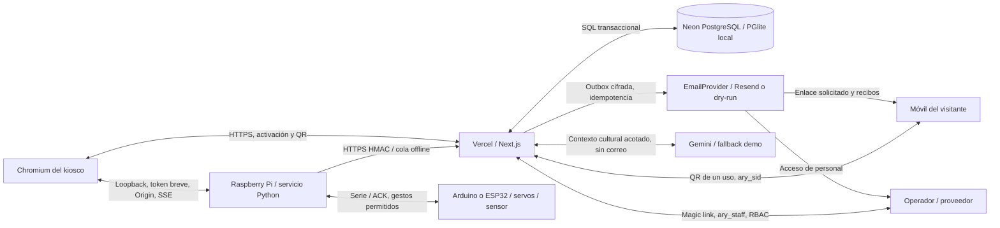

# Arquitectura de Ary

Etapas 1–4B. Next.js App Router en Vercel, PostgreSQL por Drizzle; PGlite solo en desarrollo y tests. Las flechas representan contratos implementados, no conexiones de producción acreditadas.

## Fronteras de acceso

- Visitante: sesión aleatoria, token con hash, cookie HttpOnly. QR transfiere selecciones a una sesión distinta y limpia el kiosco. `originKioskId` conserva solo la atribución al dispositivo para estadísticas posteriores; nunca se escribe un identificador de visitante en analytics.
- Personal: `auth_magic_links.purpose=staff_login`, TTL 15 minutos y canje transaccional único. Invitaciones usan `staff_invite`. `staff_sessions` almacena hash; cookie `ary_staff` HttpOnly, Strict, Secure en producción y ocho horas. Se rota al entrar. `ary_sid` nunca autoriza administración.
- Tenant: `requireStaff({ roles, organizationId })` revalida organización/membresía activas en cada página y API. Partner usa el predicado SQL de organización incluso en actualizaciones y borrados por ID.
- Proveedor: únicamente ofertas propias, agregados y leads dirigidos expresamente a él. La lectura une consentimiento vigente y fecha de caducidad; el payload está cifrado y solo contiene campos elegidos.
- Cron: Bearer `CRON_SECRET`, comparación constante y operaciones idempotentes. Dos cron diarios en `vercel.json`; no hay programador externo ni despliegue realizado.

## Persistencia y ciclo de vida

Migraciones 0000–0003, snapshots y rollback para pruebas. 0003 añade sesiones de personal, campañas, payload de lead cifrado e idempotencia, organización de invitación, etiquetas demo y atribución por kiosco. Ejecutar `npm run db:migrate` antes del servidor. No compartir un directorio PGlite entre procesos.

Analytics usa una lista blanca, agregación SQL y supresión de valores menores de diez en JSON, gráficos, tablas, muestra, ratios y CSV. No incluye texto, chats, correo ni perfil. Las ventanas solapadas permiten inferencias por diferencia; la supresión no equivale a privacidad diferencial. La muestra representa eventos/sesiones, no personas únicas.

Cleanup elimina sesiones de personal caducadas, leads vencidos y eventos según `ANALYTICS_RETENTION_DAYS`, además de los ciclos anteriores. Un lead revocado pierde su payload y deja de estar disponible; la supresión no puede retirar copias que alguien ya haya visto.

## Evidencia y límites

Unitarias PostgreSQL local y HTTP simulado; E2E preparados. [Informe actual](ARY_STAGE4B_REPORT.md). Neon real, email real, ejecución de cron desplegada y robot físico requieren configuración/verificación independiente. No se usó Gemini en esta etapa; el nodo del diagrama corresponde a la integración previa. No hay MFA nativo; añadir TOTP o un IdP con MFA exigiría una integración futura y pruebas de recuperación/rotación.
