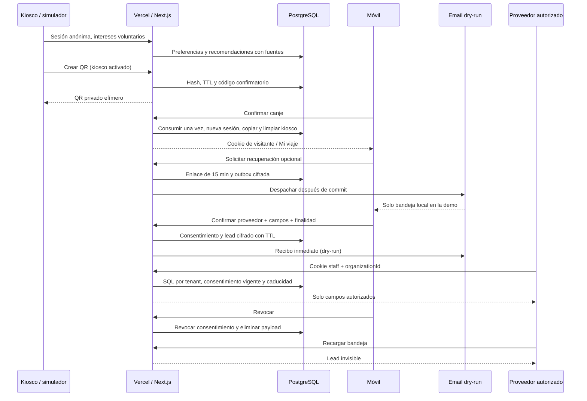

# Diagrama técnico WRO

Nube/Pi/Gemini y fronteras completas: [arquitectura](ARY_ARCHITECTURE.md). La Raspberry Pi mantiene el control físico local; Vercel solo recibe telemetría firmada y ofrece mantenimiento secundario. En esta demo no se contacta Gemini, no sale correo y no se acredita hardware físico.

El operador ve agregados, muestra y supresión, nunca el chat o una lista de correos en analítica. Eventos de demo se crean sintéticamente; no son visitantes reales ni resultados comerciales.
